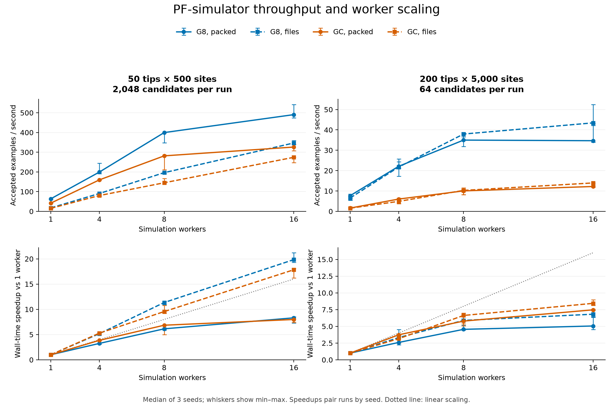
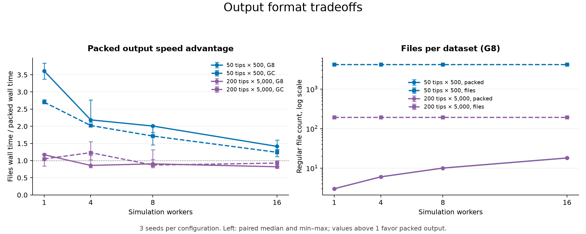

# Jean Zay benchmark results

Source: `all-metrics.csv` (SHA-256 `5ad71b274d7d05a342da76abd9c0d5d66e98a8a3adfcce90658bfc5fb34810ef`).
Selected array **1871281**: 96 completed runs, 32 configurations × 3 seeds. Excluded 1 earlier run(s) to keep the grid balanced.

Node(s): jean-zay-pp3. All runs used the same binary (`def00baddb064cc3eb1fcd1ac4133029da068d3cb5bc0d3cd622c8d9d4afd123`) and reported exit code 0.

## Throughput and scaling

Rates and times below are medians across seeds. Speedups are medians of the three seed-paired wall-time ratios, so they need not equal ratios of the displayed medians.

| Tips × sites | Gamma | Format | Wall s, 1 worker | Wall s, 16 workers | Accepted/s, 1 worker | Accepted/s, 16 workers | Paired speedup, 16 workers |
|---|---|---|---:|---:|---:|---:|---:|
| 50 × 500 | G8 | packed | 22.29 | 2.83 | 63.57 | 490.68 | 8.31× |
| 50 × 500 | G8 | files | 80.44 | 4.00 | 17.48 | 346.92 | 19.84× |
| 50 × 500 | GC | packed | 32.69 | 4.19 | 41.64 | 326.24 | 7.99× |
| 50 × 500 | GC | files | 89.72 | 5.02 | 15.23 | 274.19 | 17.84× |
| 200 × 5,000 | G8 | packed | 8.33 | 1.84 | 7.69 | 34.69 | 5.05× |
| 200 × 5,000 | G8 | files | 9.75 | 1.47 | 6.56 | 43.45 | 6.81× |
| 200 × 5,000 | GC | packed | 39.77 | 5.24 | 1.61 | 12.21 | 7.47× |
| 200 × 5,000 | GC | files | 41.23 | 4.59 | 1.55 | 13.95 | 8.44× |

## Acceptance

Each seed is counted once per workload/model, using the 1-worker packed run. Accepted counts and rejection categories match exactly across worker counts and formats for every seed.

| Tips × sites | Gamma | Candidates | Accepted | Acceptance | Duplicate failures | Window failures |
|---|---|---:|---:|---:|---:|---:|
| 50 × 500 | G8 | 6,144 | 4,176 | 67.97% | 1,947 | 21 |
| 50 × 500 | GC | 6,144 | 4,091 | 66.59% | 2,031 | 22 |
| 200 × 5,000 | G8 | 192 | 192 | 100.00% | 0 | 0 |
| 200 × 5,000 | GC | 192 | 192 | 100.00% | 0 | 0 |

## Output format and CPU use

| Tips × sites | Workers | Packed/files wall-time gain, G8 | Packed/files wall-time gain, GC | Packed file count, G8 | Separate file count, G8 |
|---|---:|---:|---:|---:|---:|
| 50 × 500 | 1 | 3.61× | 2.70× | 3 | 4,168 |
| 50 × 500 | 4 | 2.19× | 2.02× | 6 | 4,168 |
| 50 × 500 | 8 | 2.01× | 1.72× | 10 | 4,168 |
| 50 × 500 | 16 | 1.41× | 1.24× | 18 | 4,168 |
| 200 × 5,000 | 1 | 1.17× | 1.05× | 3 | 193 |
| 200 × 5,000 | 4 | 0.86× | 1.23× | 6 | 193 |
| 200 × 5,000 | 8 | 0.91× | 0.87× | 10 | 193 |
| 200 × 5,000 | 16 | 0.82× | 0.93× | 18 | 193 |

## Interpretation

- For 50-tip, 500-site examples, packed output is 3.61× faster than separate files at one worker with G8, falling to 1.41× at 16 workers. Its file count falls from about 4,168 to 3–18. At 16 workers it reaches about 491 accepted examples/s with G8.
- For 200-tip, 5,000-site examples, packed output is not consistently faster. At 16 workers, G8 reaches about 35 accepted examples/s packed versus 43 with separate files. Both use about 159 MiB of logical output; packed output reduces 193 files to 18. This grid has only 64 candidates per large run, leaving little work per worker at 16 workers.
- G8 is faster than continuous gamma in every matched configuration in this grid. For large examples the median seed-paired G8 throughput advantage ranges from 2.93× to 4.78×. These are different rate models, not interchangeable simulation priors.
- The low serial CPU use for small separate-file runs (median 0.28 cores for G8, 0.38 for GC), compared with roughly one core for packed runs, is consistent with substantial I/O or scheduling waits. The CSV alone cannot isolate the cause. The apparent superlinear scaling of separate files is relative to this slow serial baseline, not evidence of superlinear CPU computation.
- For large G8 packed runs, median wall time is effectively flat from 8 to 16 workers (1.83 to 1.84 s). More workers increase total CPU cost without improving median throughput for these short batches. Larger batches are needed to assess sustained scaling.

## Scope and limitations

- This compares this simulator's worker counts, rate models and output formats. There are no Python reference measurements in this CSV.
- The supplied benchmark script uses indels, ancestral sequences, gapped and window duplicate checks, and one attempt per candidate. It requests candidate counts rather than enforcing accepted output counts. The CSV itself does not retain the full command, so exact settings should be confirmed from the per-run simulation summaries.
- All rows identify `jean-zay-pp3`. The CSV does not establish exclusive CPU allocation or whether other array jobs overlapped. The current script permits four concurrent tasks (`%4`), so shared-resource contention is possible. Validate on the intended compute partition with isolated runs before treating these as production capacity estimates.
- Three different seeds vary both simulation cost and the number of accepted samples. Whiskers are observed min–max ranges, not confidence intervals. Format comparisons and speedups pair the same seeds; G8 and GC may retain different numbers of small examples.
- Timing includes executable startup and buffered output writes. Data enumeration and cleanup happen after timing. Logical output bytes are not physical filesystem usage or a measurement of sustained disk bandwidth. Tar rotation at the 1 GiB target is not exercised by these datasets.

All 32 configuration summaries, including min/max timings and CPU use, are in `summary.csv`. Figures are also available as vector PDFs.
