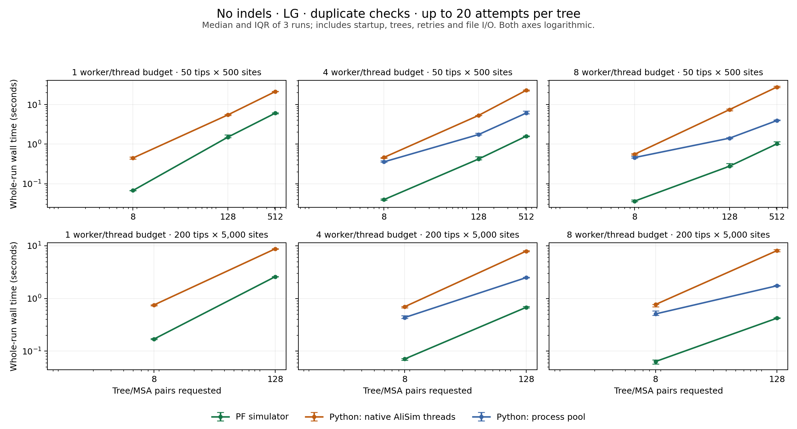

# Python reference versus PF simulator: no indels, duplicate checks enabled

Recorded 2026-11-02T08:40:41.776296+00:00 on macOS-27.0.1-arm64-arm-64bit; 10 logical CPUs. 3 rounds, release Rust binary, Python 3.12.7.

## Findings

- Across the larger batches, Rust is **3.3–3.6× faster than the one-thread Python
  reference**, and **3.9–4.1× faster than an eight-worker Python process pool**
  (paired median ratios for `batch_50` and `batch_200`).
- The cleanest comparison is 128 pairs × 200 tips × 5,000 sites: every run writes
  all 128 pairs. Single-thread medians are **8.781 s Python / 2.597 s Rust**;
  eight-worker medians are **1.744 s Python pool / 0.423 s Rust**.
- Python's original `--processes N` setting gives AliSim native threads while
  leaving the outer loop sequential. It provides little benefit here and is
  slower for the 500-site batches at eight threads. The added Python process
  pool is the more competitive parallel reference; comparing only against the
  original threading strategy would overstate Rust's advantage over parallel Python.
- Eight-worker speedup over each implementation's serial path is approximately
  **6× for Rust** and **5× for the Python pool** on the larger batches. Tiny batches
  have a larger Rust advantage dominated by interpreter/import/worker startup.
- All **120 timed runs** completed; every emitted MSA passed tip-ID/count,
  length and uniqueness validation. Rust and Python pool outputs are each
  reproducible across their worker counts. Cross-language and native-thread-count
  datasets/retry counts differ, so retention and accepted throughput are reported.



## Matched single-threaded and parallel wall times

| Case | Pairs requested | Tips × sites | Worker/thread budget | Rust (s) | Python native threads (s) | Python pool (s) | Python native / Rust | Python pool / Rust |
| --- | ---: | --- | ---: | ---: | ---: | ---: | ---: | ---: |
| small_50 | 8 | 50 × 500 | 1 | 0.067 | 0.447 | 0.447 | 6.69× | 6.69× |
| small_50 | 8 | 50 × 500 | 4 | 0.039 | 0.461 | 0.356 | 10.97× | 9.19× |
| small_50 | 8 | 50 × 500 | 8 | 0.036 | 0.557 | 0.459 | 15.34× | 12.74× |
| medium_50 | 128 | 50 × 500 | 1 | 1.506 | 5.494 | 5.494 | 3.42× | 3.42× |
| medium_50 | 128 | 50 × 500 | 4 | 0.422 | 5.344 | 1.754 | 12.67× | 4.05× |
| medium_50 | 128 | 50 × 500 | 8 | 0.277 | 7.481 | 1.417 | 23.89× | 4.89× |
| batch_50 | 512 | 50 × 500 | 1 | 6.081 | 21.371 | 21.371 | 3.60× | 3.60× |
| batch_50 | 512 | 50 × 500 | 4 | 1.587 | 22.910 | 6.091 | 14.44× | 3.91× |
| batch_50 | 512 | 50 × 500 | 8 | 1.019 | 27.849 | 3.956 | 25.90× | 3.86× |
| small_200 | 8 | 200 × 5000 | 1 | 0.169 | 0.752 | 0.752 | 4.14× | 4.14× |
| small_200 | 8 | 200 × 5000 | 4 | 0.071 | 0.698 | 0.435 | 9.99× | 6.12× |
| small_200 | 8 | 200 × 5000 | 8 | 0.064 | 0.769 | 0.509 | 12.25× | 8.80× |
| batch_200 | 128 | 200 × 5000 | 1 | 2.597 | 8.781 | 8.781 | 3.33× | 3.33× |
| batch_200 | 128 | 200 × 5000 | 4 | 0.679 | 7.920 | 2.489 | 11.45× | 3.67× |
| batch_200 | 128 | 200 × 5000 | 8 | 0.423 | 8.106 | 1.744 | 19.16× | 4.07× |

Times are independent medians; ratios are medians of same-round ratios. A value greater than 1 in the last columns favors Rust. The one-thread Python result is shared as both Python baselines, not measured twice.

## Paired speedup variability

| Case | Budget | Python native / Rust, median [IQR] | Python pool / Rust, median [IQR] |
| --- | ---: | ---: | ---: |
| batch_50 | 1 | 3.60× [3.44–3.67] | 3.60× [3.44–3.67] |
| batch_50 | 4 | 14.44× [14.12–14.57] | 3.91× [3.74–4.25] |
| batch_50 | 8 | 25.90× [24.55–27.50] | 3.86× [3.44–4.13] |
| batch_200 | 1 | 3.33× [3.32–3.38] | 3.33× [3.32–3.38] |
| batch_200 | 4 | 11.45× [11.35–11.56] | 3.67× [3.58–3.69] |
| batch_200 | 8 | 19.16× [17.95–20.26] | 4.07× [3.99–4.18] |

IQRs summarize the three same-round time ratios; they are descriptive variability,
not confidence intervals. Timing ratios include the observed retries and failures.

## Retention and throughput

| Case | Backend | Budget | Median written / requested | Accepted MSAs/s | Speedup vs own serial |
| --- | --- | ---: | ---: | ---: | ---: |
| small_50 | rust | 1 | 8 / 8 | 118.8 | 1.00× |
| small_50 | python_threads | 1 | 8 / 8 | 17.9 | 1.00× |
| small_50 | rust | 4 | 8 / 8 | 202.8 | 1.71× |
| small_50 | python_threads | 4 | 8 / 8 | 17.4 | 1.07× |
| small_50 | python_pool | 4 | 8 / 8 | 22.5 | 1.28× |
| small_50 | rust | 8 | 8 / 8 | 220.5 | 1.84× |
| small_50 | python_threads | 8 | 8 / 8 | 14.4 | 0.80× |
| small_50 | python_pool | 8 | 8 / 8 | 17.4 | 0.97× |
| medium_50 | rust | 1 | 127 / 128 | 84.4 | 1.00× |
| medium_50 | python_threads | 1 | 127 / 128 | 23.1 | 1.00× |
| medium_50 | rust | 4 | 127 / 128 | 301.0 | 3.57× |
| medium_50 | python_threads | 4 | 127 / 128 | 23.8 | 1.03× |
| medium_50 | python_pool | 4 | 127 / 128 | 72.4 | 3.01× |
| medium_50 | rust | 8 | 127 / 128 | 458.6 | 5.34× |
| medium_50 | python_threads | 8 | 124 / 128 | 16.6 | 0.73× |
| medium_50 | python_pool | 8 | 127 / 128 | 89.6 | 3.80× |
| batch_50 | rust | 1 | 504 / 512 | 82.7 | 1.00× |
| batch_50 | python_threads | 1 | 505 / 512 | 23.4 | 1.00× |
| batch_50 | rust | 4 | 504 / 512 | 317.0 | 3.83× |
| batch_50 | python_threads | 4 | 504 / 512 | 22.0 | 0.96× |
| batch_50 | python_pool | 4 | 505 / 512 | 82.3 | 3.51× |
| batch_50 | rust | 8 | 504 / 512 | 493.7 | 5.96× |
| batch_50 | python_threads | 8 | 494 / 512 | 17.9 | 0.77× |
| batch_50 | python_pool | 8 | 505 / 512 | 127.7 | 5.31× |
| small_200 | rust | 1 | 8 / 8 | 47.3 | 1.00× |
| small_200 | python_threads | 1 | 8 / 8 | 10.6 | 1.00× |
| small_200 | rust | 4 | 8 / 8 | 112.5 | 2.42× |
| small_200 | python_threads | 4 | 8 / 8 | 11.5 | 1.08× |
| small_200 | python_pool | 4 | 8 / 8 | 18.4 | 1.77× |
| small_200 | rust | 8 | 8 / 8 | 125.9 | 2.61× |
| small_200 | python_threads | 8 | 8 / 8 | 10.4 | 0.99× |
| small_200 | python_pool | 8 | 8 / 8 | 15.7 | 1.48× |
| batch_200 | rust | 1 | 128 / 128 | 49.3 | 1.00× |
| batch_200 | python_threads | 1 | 128 / 128 | 14.6 | 1.00× |
| batch_200 | rust | 4 | 128 / 128 | 188.6 | 3.89× |
| batch_200 | python_threads | 4 | 128 / 128 | 16.2 | 1.11× |
| batch_200 | python_pool | 4 | 128 / 128 | 51.4 | 3.51× |
| batch_200 | rust | 8 | 128 / 128 | 302.5 | 6.21× |
| batch_200 | python_threads | 8 | 128 / 128 | 15.8 | 1.08× |
| batch_200 | python_pool | 8 | 128 / 128 | 73.4 | 4.96× |

## What is timed

- Whole-run wall time: executable/interpreter startup, imports, empirical input loading, tree generation and transformations, AliSim calls, duplicate checking/retries, output file I/O, worker startup/shutdown, and final summary. File validation, hashing and deletion are outside timing.
- Both use the validated birth-death/inherited-rate/empirical-diameter/terminal-repair tree prior and LG amino acids without Gamma or indels. There is one MSA per tree, with up to 20 attempts on that fixed tree, skipping exhausted samples without replacement. No ancestors or window selection.
- Rust is the unmodified production CLI with `--preset python --model LG --max-attempts 20`. It uses numeric duplicate checking, direct tree input and one native thread per worker.
- Python imports the actual `SimulateAlterRescale.py.simulateTree` and `alisim.py.simulate_alignment` functions. The reference combines both stages in one interpreter rather than paying Snakemake and two separate interpreter startups; this is a conservative reference.
- `python_threads` mirrors the script: sequential per-tree work and N native AliSim threads (the script’s `--processes N`). `python_pool` is a benchmark-only parallel scheduler over the same functions, with N persistent Python workers and one AliSim thread each. The original script has no such pool. Rust uses N persistent process workers for N > 1.
- Python retains its normal shell launch, per-attempt standalone startup, FASTA I/O and parsing for duplicate checks, and default log generation/deletion. Launch instrumentation only pins the standalone executable, deterministic attempt seeds and overwrite behavior. Default CPU kernels are used. No production Python source is modified.
- Python uses standalone IQ-TREE 2.4.0 from the pinned source, matching the linked library version. The older installed 2.2.2.6 is excluded to avoid mixing version/build differences with bridge speed. Standalone OpenMP and linked sequential builds remain different builds.
- Per-sample Python/NumPy/DendroPy RNG seeds are reset to make Python pool scheduling deterministic. Python and Rust tree/RNG algorithms differ, so datasets and retry counts need not match across languages. These are matched prior/policy comparisons, not identical sequence trajectories. Written counts and accepted throughput are reported rather than assuming identical work.
- Rejected Python tree files are removed so both outputs contain complete accepted pairs only. The original tree script would leave these trees on disk. Python attempt counts and summed tree/MSA function times are in runs.csv; Rust does not expose an attempt total.
- After each run, every accepted MSA is checked for tip count/IDs, length and unique sequences, and tree/MSA sample IDs must match. Rust hashes must match across worker counts; Python one-thread/pool hashes must match across worker counts. Multi-thread AliSim streams may differ.
- Runs are sequential, with rotating case/backend order, one unmeasured warmup per setting, normal buffered filesystem I/O and no fsync. This is warm local-filesystem CLI completion time, not durable or network-storage throughput. Small batches are dominated by startup costs.

## Indel follow-up: duplicate checking disabled

The [indel benchmark](../python_indels/REPORT.md) adds raw LG simulations with
0.002/0.002 POW{1.7/100} indels, allowing duplicates and stopping before
`find_unduplicated`. Every sample is simulated once and retained. Gamma
remains disabled to keep the model settings matched to the LG comparison.

| Pairs × tips × root sites | Workers | Rust (s) | Python with ancestors (s) | Python tips only (s) |
| --- | ---: | ---: | ---: | ---: |
| 128 × 50 × 500 | 1 | 1.135 | 5.400 | 5.303 |
| 128 × 50 × 500 | 8 | 0.188 | 1.328 | 1.274 |
| 128 × 200 × 5,000 | 1 | 4.296 | 39.791 | 37.011 |
| 128 × 200 × 5,000 | 8 | 0.728 | 7.281 | 6.423 |

Medians over three rounds. Python includes its truncated `.fa`, full
`.untrimmed`, and unaligned outputs; the ancestor-enabled reference also
exports internal rows. Rust emits full aligned/unaligned tips only. The
tip-only Python control holds tip trajectories exactly fixed, separating
ancestral export from the remaining implementation costs. Four-worker
results, IQRs, throughput and validation details are in the follow-up report.

## Reproduce

```sh
cargo build --release
/path/to/legacy/.venv/bin/python benchmarks/benchmark_python.py --output benchmarks/python-new
/path/to/legacy/.venv/bin/python benchmarks/plot_python.py --input benchmarks/python-new
```

Raw measurements: [runs.csv](runs.csv), [summary.csv](summary.csv), [metadata.json](metadata.json). Raw distribution validation: [report](../../validation/python_raw/REPORT.md).
