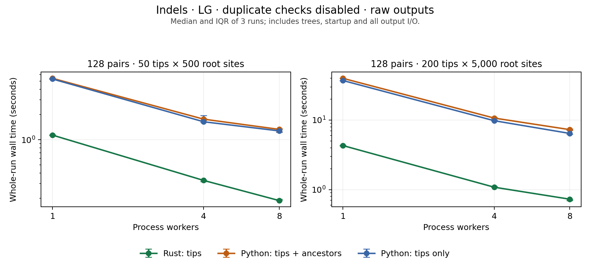

# Python versus Rust: indels, no duplicate checking

Full raw simulation before `find_unduplicated`: LG without Gamma, Python birth-death tree prior, insertion/deletion rates 0.002/0.002 and POW{1.7/100} sizes. Every tree produces one MSA; no retry, rejection, window search or cropping by Rust.

3 rounds per case and setting, 10 logical CPUs, release Rust binary; Python 3.12.7. Standalone and linked AliSim are both 2.4.0.



| Case | Pairs | Tips × root sites | Workers | Rust (s) | Python with ancestors (s) | Python tips only (s) | Ancestor Python / Rust | Tip-only Python / Rust |
| --- | ---: | --- | ---: | ---: | ---: | ---: | ---: | ---: |
| indels_50 | 128 | 50 × 500 | 1 | 1.135 | 5.400 | 5.303 | 4.68× | 4.69× |
| indels_50 | 128 | 50 × 500 | 4 | 0.327 | 1.758 | 1.637 | 5.30× | 5.09× |
| indels_50 | 128 | 50 × 500 | 8 | 0.188 | 1.328 | 1.274 | 6.53× | 6.83× |
| indels_200 | 128 | 200 × 5000 | 1 | 4.296 | 39.791 | 37.011 | 9.23× | 8.49× |
| indels_200 | 128 | 200 × 5000 | 4 | 1.083 | 10.682 | 9.788 | 9.86× | 9.04× |
| indels_200 | 128 | 200 × 5000 | 8 | 0.728 | 7.281 | 6.423 | 10.00× | 9.33× |

Times are medians of whole-run wall time; speedups are medians of same-round ratios. All settings retain all requested pairs. IQRs and throughput are in [summary.csv](summary.csv).

## Reference and output scope

- The reference calls the actual `SimulateAlterRescale.py.simulateTree` and `alisim.py.simulate_alignment` functions with `add_indels=True` and `allow_duplicate_sequences=True`. It stops before `find_unduplicated`; Gamma is disabled explicitly to match the preceding LG benchmark and the current Rust CLI.
- The primary reference also sets `ancestral=True`, as the Snakefile does. The tip-only Python control changes only this flag. Python tip trajectories are checked for exact equality across these two flags; otherwise no cross-language byte identity is assumed.
- Python still creates its first-L-column `.fa`, full `.fa.untrimmed`, and `.unaligned.fa` files. All that I/O and ancestral export is included. Raw and unaligned files are moved into the same directory layout as Rust, and the truncated file is retained under `trimmed_sequences/`; these renames are timed. No record filtering or sequence rewriting is added by the harness.
- Rust emits full aligned and unaligned **tips only**, with duplicate checking disabled. Consequently the ancestor-enabled Python comparison includes extra output work; use the tip-only control to assess that contribution. Even this control retains Python’s truncated file and default log generation/deletion.
- AliSim is forced to one native thread by `alisim.py` whenever indels are enabled. Thus 1 means sequential execution; 4 and 8 mean persistent process workers on both sides. The Python pool is a benchmark-only scheduler, not the original script’s `--processes` flag. Both versions of the Python reference share this scheduler.

## Timing and validation

- Includes process/interpreter startup, imports, empirical tree-input loading, tree generation/transformation, AliSim simulation, all native/Python output writes, and worker shutdown. Python stages are combined in one interpreter, excluding Snakemake and a second interpreter startup. Filesystem writes are buffered, without fsync.
- One unmeasured two-sample warmup per setting; three rounds by default, rotating case/setting order. Runs are sequential, on fresh temporary output directories. Validation, hashing and directory deletion are outside the timed region.
- Each Python simulation must launch exactly once; every backend must write every requested sample with zero duplicate failures. Duplicated tip sequences are counted but never rejected. Output IDs, row counts and lengths are checked. Every raw aligned row (including Python ancestors) must exactly reconstruct its corresponding unaligned sequence after gap removal; Python’s truncated rows must match the first L columns.
- Sample seeds use the same independent Python/NumPy/DendroPy stream setup as the earlier benchmark. Data hashes must be invariant across worker counts per backend; Python ancestral/tip-only hashes for tip rows must match. Tree/RNG trajectories still differ between Rust and Python, while priors/settings match. Rust simulation behavior is unchanged.

All 54 runs completed. The raw files contain 1,149,696 exact aligned-to-unaligned row checks; 1,107 output MSAs contained duplicate tip sequences (counts include repeated seeds across worker settings).

## Reproduce

```sh
/path/to/legacy/.venv/bin/python benchmarks/benchmark_python_indels.py --output benchmarks/python_indels-new
/path/to/legacy/.venv/bin/python benchmarks/plot_python_indels.py --input benchmarks/python_indels-new
```

Raw measurements: [runs.csv](runs.csv), [summary.csv](summary.csv), [metadata.json](metadata.json). [No-indel benchmark](../python/REPORT.md).
