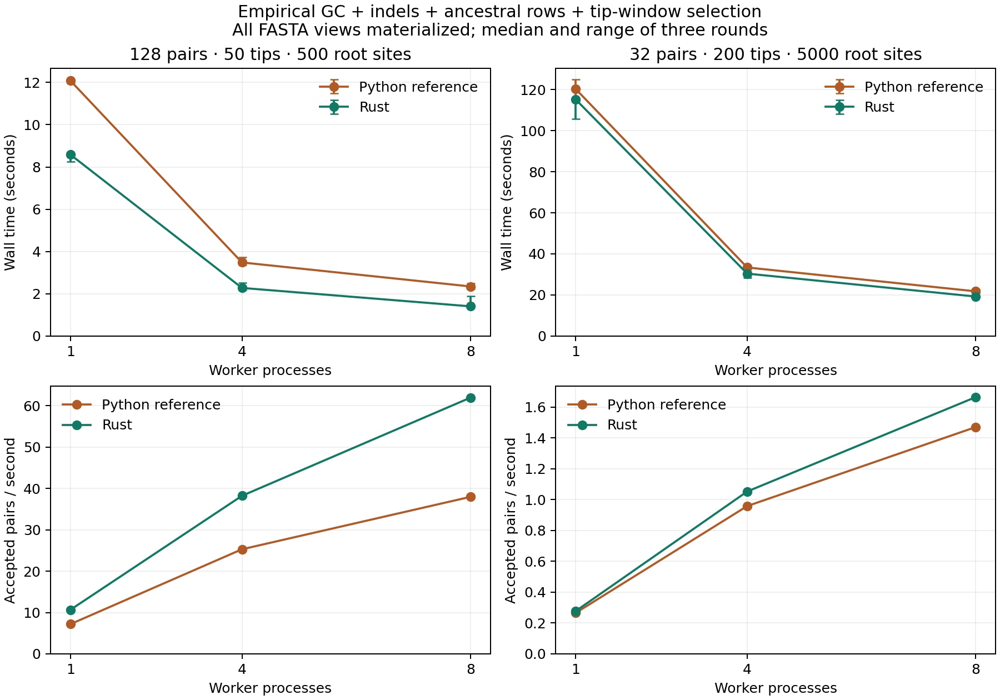

# Python pipeline timing: empirical GC, ancestors, indels and windows

Both generate Python-prior trees and LG + empirical GC with POW indels 0.002/0.002, export ancestors, check full gapped tips and the first unique length-L tip window, and materialize full/selected/ungapped FASTAs. One attempt per tree; no ungapped duplicate check or replacement.

| Case (pairs × tips × root sites) | Workers | Rust seconds | Python seconds | Median paired speedup | Rust retained | Python retained |
| --- | ---: | ---: | ---: | ---: | ---: | ---: |
| 128 × 50 × 500 | 1 | 8.581 | 12.080 | 1.41× | 88/128 | 87/128 |
| 128 × 50 × 500 | 4 | 2.275 | 3.481 | 1.54× | 88/128 | 87/128 |
| 128 × 50 × 500 | 8 | 1.403 | 2.345 | 1.65× | 88/128 | 87/128 |
| 32 × 200 × 5000 | 1 | 115.179 | 120.280 | 1.09× | 32/32 | 32/32 |
| 32 × 200 × 5000 | 4 | 30.384 | 33.380 | 1.10× | 32/32 | 32/32 |
| 32 × 200 × 5000 | 8 | 19.212 | 21.752 | 1.10× | 32/32 | 32/32 |

## Cost breakdown follow-up

A [controlled ablation](../pipeline_costs/REPORT.md) isolates the cause of the smaller speedup. At 200 tips × 5,000 sites, continuous Gamma increases linked-engine time from **20 ms to 3,580 ms per candidate** with indels held fixed. Adding ancestral output gives **3,679 ms**; combined gapped/window checking costs **2.09 ms** (0.057% of engine time). Standalone AliSim also becomes much slower under continuous Gamma. The shared native-engine cost dominates the latest workload; window checking is a small fraction. These are separate short serial phase measurements, not replacements for the end-to-end timings above.

## Findings

Rust remains faster with the requested pipeline options, but the gain is much
smaller than in the earlier tip-only/fixed-rate comparisons: **1.41–1.65×** for
50 tips, and **1.09–1.10×** for 200 tips and 5,000 root sites. These are medians
of Python/Rust time ratios paired by round, not ratios of the displayed medians.
The three-round ranges overlap for the large serial case; this is a modest
measured advantage, not evidence of a large engine speed difference.

Process parallelism remains useful. Rust's median paired speedup from one to
eight workers is **6.07×** for the small case and **5.55×** for the large case.
Python's corresponding values are 5.17× and 5.32×. This machine reports ten logical
CPUs. The comparison changes Gamma, ancestral output, selection and materialization
together relative to older reports, so it does not identify their individual costs.

Retained counts differ between languages because their RNGs differ, while being
identical across worker counts within a language. Across the three independent
seeds (counting each seed once), the small case retained **267/384 (69.53%)** in
Rust and **264/384 (68.75%)** in Python. Both retained **96/96** in the large case.
These sample sizes are for timing; they do not establish post-selection prior
equality or a statistically significant retention difference.

| Case | Workers | Rust accepted pairs/s | Python accepted pairs/s |
| --- | ---: | ---: | ---: |
| 50 tips, 500 root sites | 1 | 10.678 | 7.202 |
| 50 tips, 500 root sites | 4 | 38.236 | 25.300 |
| 50 tips, 500 root sites | 8 | 61.989 | 37.991 |
| 200 tips, 5000 root sites | 1 | 0.278 | 0.266 |
| 200 tips, 5000 root sites | 4 | 1.053 | 0.959 |
| 200 tips, 5000 root sites | 8 | 1.666 | 1.471 |



[PDF version](scaling.pdf). Error bars show the minimum and maximum of three
rounds; they are not confidence intervals.

## Scope and interpretation

- Each timing is the median of 3 interleaved rounds. Timing includes process startup/imports, tree generation, simulation, selection, output I/O and worker shutdown. Independent validation and temporary-directory cleanup are outside timing. No Snakemake scheduling overhead is charged.
- Python calls the actual legacy functions, with only invocation parameters and native seeds provided by the harness. It uses the unadapted pinned AliSim 2.4.0 executable. One worker is the script’s serial tree loop; 4/8 workers are an optimized process-pool reference, each with one native thread. Indels force one native thread in the original script.
- Python writes raw and ungapped files for rejected candidates, plus its initial first-L truncation and native labelled tree. Rust skips serialization of rejected candidates and has no redundant prefix file; Rust additionally writes provenance/window metadata. These are production workflow differences, not identical disk workloads. All are included in timing.
- Full/selected/ungapped rows include ancestors for BOTH backends. Window and duplicate checks use tips only, with the legacy excluded-final-window endpoint. The M == L unique case selects offset zero, matching the actual script after its full-tip duplicate check.
- Within each backend, dataset hashes must match across worker counts for the same seed. Across backends, trees, alpha draws and sequence RNG streams differ: equal numeric seeds do not imply identical datasets. Retention and accepted throughput are reported explicitly. These timing batches do not replace the larger distribution validations.
- Filesystem page caches are warm; there is no forced fsync or cache eviction. No other benchmark is run concurrently by the harness.

## Verification

All 36 timed runs passed independent validation. 423,171 exact aligned-to-ungapped checks and 387,531 selected-row checks passed, including ancestors. Retained offsets were independently checked by exhaustive exact tip-row comparisons. All within-backend worker-count hashes agreed.

## Reproduce

```bash
cargo build --release
/path/to/legacy/.venv/bin/python benchmarks/benchmark_python_pipeline.py \
  --binary target/release/pf-sim \
  --reference target/alisim-reference/build/iqtree/iqtree2 \
  --legacy-root /path/to/bayesnj_simulation/scripts \
  --output benchmarks/python_pipeline
```

See [runs.csv](runs.csv) for all timings, counts, output sizes, hashes and commands; [metadata.json](metadata.json) records input/source/binary identities, platform and policy; [summary.csv](summary.csv) contains grouped statistics.

## Provenance and implementation

Ancestral output was added to the numeric bridge for this comparison and exposed
through `--ancestral`. It preserves all-node alignment coordinates and exports
internal labels matching the saved tree. Exact checks against the bridge's AliSim
FASTA writer cover rooted/unrooted trees with and without indels; CLI tests cover
all materialized views and worker-count determinism. No input-tree or intermediate
MSA file is required by the direct numeric path.

[measured_sources.tar.gz](measured_sources.tar.gz) preserves every source/input
listed in the timing metadata, including the harness and external phylotree
sources. IQ-TREE itself remains identified by its pinned commit and reference
binary hash. Build and benchmark setup/warmup time are outside the timed runs.
The [sizing pilot](../python_pipeline_pilot/REPORT.md), which initially used 128
large-tree pairs, is retained separately and is not pooled with these results.

## Materialization volume

Median logical file bytes at one worker, excluding the run summary:

| Case | Rust MiB | Python MiB |
| --- | ---: | ---: |
| pipeline_50 | 13.7 | 24.1 |
| pipeline_200 | 203.3 | 263.6 |

Python includes rejected raw intermediates, prefix FASTAs and native labelled trees; Rust includes accepted-sample provenance metadata. These volumes describe the timed workflows, not identical archives.

## Post-measurement compatibility check

A final regression check exposed unnamed internal-node labels in the library's
Newick-file numeric API. The fallback now uses AliSim's numeric node IDs. The
benchmark's direct-tree CLI already assigned explicit labels and is unaffected;
[postcheck.json](postcheck.json) confirms identical sample hashes between the
measured executable and the updated executable on the compatibility case. All
timings above remain those of the exact measured build preserved by the source
archive and binary hash; the final test suite additionally covers unnamed trees.
