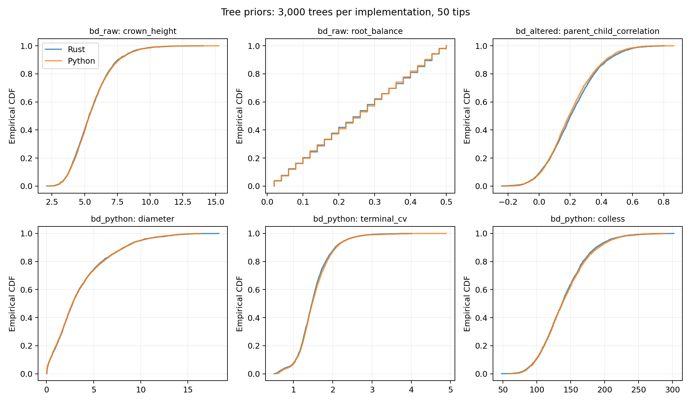

# Tree-prior distribution comparison

3,000 independent trees per implementation per case/tip count; 228 tree-level comparisons.
Family-wise alpha 0.01; two-sample KS/DKWM Bonferroni critical distance **0.0598**.

**0 detected differences** in the intended matching-prior comparisons.

This is evidence of agreement at the measured resolution, not proof of equality of all tree distributions.
Prior agreement also relies on the explicit construction/conditioning rules and structural tests below.

| Pipeline | Tips | Largest KS D | Metric | Detected differences |
| --- | ---: | ---: | --- | ---: |
| bd_raw | 10 | 0.0277 | terminal_mean | 0/14 |
| bd_raw | 50 | 0.0290 | terminal_cv | 0/14 |
| bd_raw | 200 | 0.0323 | sackin | 0/14 |
| bd_altered | 10 | 0.0263 | root_balance | 0/14 |
| bd_altered | 50 | 0.0343 | parent_child_correlation | 0/14 |
| bd_altered | 200 | 0.0313 | colless | 0/14 |
| bd_python | 10 | 0.0383 | crown_height | 0/16 |
| bd_python | 50 | 0.0290 | terminal_cv | 0/16 |
| bd_python | 200 | 0.0237 | min_terminal | 0/16 |
| bd_python_bl | 10 | 0.0343 | total_length | 0/16 |
| bd_python_bl | 50 | 0.0323 | diameter | 0/16 |
| bd_python_bl | 200 | 0.0353 | colless | 0/16 |
| ete3 | 10 | 0.0380 | min_terminal | 0/16 |
| ete3 | 50 | 0.0373 | terminal_cv | 0/16 |
| ete3 | 200 | 0.0333 | diameter | 0/16 |

## Negative controls

| Deliberate mismatch | Metric | KS D | Detected |
| --- | --- | ---: | --- |
| control_bd_wrong_death | crown_height | 0.6503 | True |
| control_ete_vs_yule | root_balance | 0.1693 | True |

## Priors and transformation order

- Uniform unrooted: labeled PDA, probability 1/(2n-5)!!; uniform rooted additionally supported.
- ETE3 3.1.3: coin flip between deque ends, not uniformly choosing a leaf. Yule is a separate sampler.
- BD: start with one lineage, birth=1, death=0.5; restart extinct realizations, stop at the first n extant tips, prune extinct lineages and suppress unary nodes. No fixed crown age, GSA or extra terminal waiting time.
- Raw BD leaves are contemporaneous and exactly two newborn terminal edges are zero. Both implementations satisfy these invariants.
- bd_altered: the actual Python rate-change loop with use_bl=False, before diameter scaling and without terminal repair.
- bd_python: actual SimulateAlterRescale.py default BD transformation. bd_python_bl also tests use_bl=True.
- Rate events use exponential means 0.03 and 1.0; multipliers are LogNormal(0, sigma) with sigma=0.1 and 0.2. Descendants inherit the final parent rate. With use_bl=False, events run over the mean original branch time and integration is scaled back by original/mean.
- Empirical prior: filtered HOGENOM values plus ten replicated copies of filtered RAxML values, not tenfold diameter values; strict 0.02 < mean < 15. Draw N(mean, mean/10), clamp below at 0.02.
- Rescale altered edges to this target, then replace shorter BD terminal edges by N(0.001,0.005), rejecting draws below 0.001. This can increase the final diameter; do not rescale again. ETE3 does not apply this terminal repair.

## What was compared

All metrics are per tree: diameter, total length, crown height, height span, terminal mean/CV/minimum/zero count, internal mean, cherries, Sackin, Colless, root split balance and parent-child edge correlation. Empirical cases additionally compare sampled diameter targets and final-minus-target increments. Edges within a tree are not treated as independent samples.

Python versions: {'ete3': '3.1.3', 'dendropy': '5.0.8', 'numpy': '2.4.1'}. The actual legacy script is imported; full-pipeline trees are captured immediately before its real Newick writer. The written files are also parsed and checked for the expected 6-significant-digit rounding (maximum relative error recorded in metadata). Rust uses the same TreeSimulation generator called by pf-sim, via examples/tree_prior_samples.rs.

Near-zero height spans and diameter increments are coalesced at relative/absolute tolerance 1e-10 to avoid treating floating-point roundoff as a prior difference. Rust emits full-precision lengths; ETE3 writes only 6 significant digits, so the stochastic-prior comparison uses pre-serialization lengths on both sides.

The two-sample DKWM bound p <= 2 exp(-n D²) applies to equal cohort sizes n >= 458; Bonferroni controls the declared family regardless of correlations among metrics. Ties make the distribution-free comparison conservative. Negative controls demonstrate sensitivity to distinct birth/death parameters and to substituting Yule for ETE3.

[Two-sample DKWM reference](https://arxiv.org/abs/1107.5356), [ETE3 populate source](https://github.com/etetoolkit/ete/blob/3.1.3/ete3/coretype/tree.py), [DendroPy birth-death source](https://jeetsukumaran.github.io/DendroPy/_modules/dendropy/model/birthdeath.html).

The PRNGs differ, so matching seeds do not produce identical trees. This comparison uses independent seeded ensembles. Finite marginal checks do not establish equality of every joint feature or exclude smaller effects.



## Reproduce

```sh
cargo build --release --example tree_prior_samples
/Users/lucblassel/Work/bayesnj_simulation/.venv/bin/python scripts/compare_tree_priors.py --samples 3000
```

Raw tree-level samples: `*-rust.csv.gz` and `*-python.csv.gz`; detailed results: `summary.csv`; source hash, versions and structural checks: `metadata.json`.
